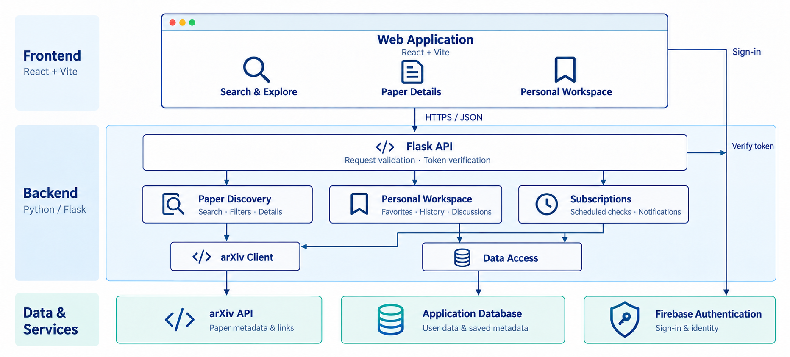

# Scholarly Insight

Discover arXiv research, save useful papers, and follow topics of interest.

## Architecture



The diagram presents the complete intended application architecture, organized into frontend, backend, and data services. It does not encode implementation status; see the feature table below for current availability.

- The browser frontend sends HTTP requests and renders the backend's JSON responses. Flask is the HTTP framework inside the Python backend.
- The arXiv client retrieves paper metadata and links. PDFs remain on arXiv; this application does not mirror its paper collection.
- Planned personal features use an application database after the backend verifies the user's Firebase ID token.
- A planned server-side subscription job checks arXiv periodically, identifies new papers, and creates in-app notifications.

## Feature status

| Area | Status | Scope |
| --- | --- | --- |
| Keyword search | Implemented | Search arXiv metadata; combine multiple terms with AND and rank by relevance. |
| Pagination | Implemented | Fetch the requested page, with up to 20 papers and navigation metadata. |
| API reliability | Implemented | Validate inputs, normalize JSON errors, handle upstream failures, and space arXiv requests. |
| Health and verification | Implemented | Lightweight reachability endpoint, browser CORS support, and offline unit/integration tests. |
| Web interface | Planned | React + Vite search pages, paper details, pagination, and a personal workspace. The frontend directory is currently a placeholder. |
| Search extensions | Planned | Author, category, and submission-date filters; paper lookup by ID; a bounded search cache. |
| Accounts and personal data | Planned | Firebase sign-in, backend token verification, favorites, and reading history. |
| Subscriptions and alerts | Planned | Daily topic checks and deduplicated in-app notifications. Email alerts are an optional extension. |
| Discussions | Planned | One discussion thread per paper, with comments and one level of replies. |
| Public release | Planned | Integration testing and a public, free-tier deployment after the application is ready. |

The current backend requires no database, Firebase project, API key, or frontend build. Planned features in this README are a development roadmap, not available endpoints.

## Quick start

Prerequisites: Conda and Python 3.12. Run commands from the repository root. Create the environment once:

```bash
conda create --name scholar --override-channels --channel conda-forge python=3.12 pip --yes --no-default-packages
conda activate scholar
python -m pip install -r requirements.txt
python -m backend.app
```

For an existing environment, start with `conda activate scholar`. All Python dependencies are maintained in the root-level `requirements.txt`.

Open these URLs while the development server is running:

- Health: `http://127.0.0.1:8000/api/health`
- Search: `http://127.0.0.1:8000/api/search?q=transformer&page=1`
- Next page: `http://127.0.0.1:8000/api/search?q=transformer&page=2`

Search URLs return JSON; a browser interface has not been implemented. Stop the server with `Ctrl+C`.

Run the automated tests separately; a running server is not required:

```bash
python -m unittest discover -s backend/tests -v
```

Tests use synthetic arXiv responses and make no external API requests. See the [backend development guide](backend/README.md) for API fields, error codes, and verification details.

## Repository layout

```text
.
├── README.md
├── requirements.txt
├── .gitignore
├── docs/
│   └── architecture.png
├── frontend/
│   └── .gitkeep
└── backend/
    ├── README.md
    ├── __init__.py              # Flask application factory
    ├── app.py                   # Development entry point
    ├── api/
    │   ├── __init__.py
    │   ├── routes.py            # Search and health endpoints
    │   └── errors.py            # Shared JSON error responses
    ├── clients/
    │   ├── __init__.py
    │   └── arxiv.py             # External API access and response parsing
    └── tests/
        ├── __init__.py
        ├── fixtures.py          # Synthetic Atom data
        ├── test_api.py          # HTTP contracts and application integration
        └── test_arxiv_client.py # Querying, parsing, pagination, and failures
```

The implemented stack is Python, Flask, Flask-CORS, Requests, ElementTree, and unittest. The proposed next stack is React + Vite for the frontend, Firebase Authentication for sign-in, and SQLAlchemy with SQLite for initial local persistence. If deployment uses an ephemeral application filesystem, persistent storage must move to a suitable external database, such as PostgreSQL. These planned technologies have not been installed or initialized. Python dependencies belong in the shared root requirements file; future browser dependencies belong in `frontend/package.json`.

As features are implemented, extend these areas rather than expanding the startup file:

| Planned location | Responsibility |
| --- | --- |
| `backend/api/<feature>.py` | Focused HTTP endpoints for details, favorites, history, subscriptions, and comments. |
| `backend/services/` | Business rules and orchestration across clients and persistence. |
| `backend/persistence/` | Database models, repositories, schema changes, and data access. |
| `backend/auth/` | Firebase token verification and user authorization. |
| `backend/jobs/` | Scheduled topic checks, checkpoints, and notification generation. |

These are extension points, not existing folders. Introduce them with working features and tests; keep `app.py` as the entry point and register new route groups in `create_app()`.

## Roadmap

1. **Complete discovery and the browser experience.** Connect the frontend to the existing search API, add filters and paper details, then introduce bounded caching without changing the current response contract unexpectedly. Label date filters as submission dates rather than journal publication dates.
2. **Add identity and personal workspaces.** Integrate Firebase Authentication, verify ID tokens on the backend, create the persistence layer, and implement favorites and reading-history operations.
3. **Add subscriptions and discussions.** Implement scheduled category checks, in-app notification management, and per-paper discussions. Finish end-to-end verification before preparing a public deployment.

### Planned data model

| Entity | Data and behavior |
| --- | --- |
| `users` | Firebase UID, display name, and creation time. Firebase manages passwords. |
| `articles` | Canonical arXiv ID, version, selected metadata, links, and cache time. No PDF binaries. |
| `favorites` | User UID, paper ID, and saved time; one favorite per user and paper. Support add, remove, and list. |
| `reading_history` | User UID, paper ID, and last-read time. Reopening updates the timestamp; allow individual deletion and clearing. |
| `subscriptions` | User UID, category or topic, and enabled state. Support creation, listing, and disabling. |
| `notifications` | Recipient, paper, event, creation time, and read state. Unique event keys prevent duplicate notifications. |
| `comments` | Paper ID, author UID, body, optional parent comment, and timestamps. Check ownership, content length, and reply depth; paginate lists. |

Subscription checks will persist per-topic checkpoints and processed identifiers. The job establishes an initial baseline, queries recent papers in date order, fetches all relevant pages, and retains a lookback window for delayed results. Users following the same topic share one upstream query. A failed check must not advance its checkpoint; retries must not create duplicate notifications. No new papers means no new notification.

Interactive searches and scheduled checks must share arXiv request coordination. A future worker cannot rely on the current process-local limiter when running in a different process. Scheduling must also account for any hosting platform's idle shutdown behavior.

## Team handoff and integration

The current public endpoints are:

| Method | Path | Purpose |
| --- | --- | --- |
| GET | `/api/search?q=...&page=...` | Keyword search with a fixed page size of 20. |
| GET | `/api/health` | Backend reachability; does not query arXiv or the database. |

The frontend renders `items` and uses the pagination flags to request adjacent pages. Keep the documented snake_case field names, including `pdf_url`. Health checks and automated tests are separate mechanisms; browser refresh does not execute the test suite.

- **Frontend responsibilities:** implement the pages, input controls, loading/error/empty states, and pagination. Later, handle Firebase sign-in, send its ID token with protected requests, and render personal data and notifications.
- **Backend responsibilities:** maintain the JSON contract and validation, integrate arXiv, and implement token verification, ownership checks, persistence, and subscription processing as features are added.
- **Shared handoff:** agree on each new endpoint and example request/response before implementation, then verify it together. Document new endpoint paths before implementation; keep the existing search path stable.

For protected operations, the backend must derive ownership from the verified Firebase UID rather than a submitted user ID. Store credentials only in local configuration or the hosting environment. Do not publish credentials, personal paths, or database files.

The modules under `api/` and `clients/` are the current implementation. Add focused service, persistence, authentication, and job modules when their features are implemented; no empty versions of those layers are included now. Frontend and backend code may eventually be deployed together or separately.

## Development conventions

- Keep project-authored code, comments, documentation, and interface text in English; preserve source authors' names and metadata accurately.
- Use the `scholar` Conda environment and root-level `requirements.txt`.
- Run relevant tests before handing off changes. Keep external calls mocked in automated tests.
- Deployment is deferred while development continues. Hosting preparation must preserve database data across application restarts and respect free-tier limits.
- Do not commit or push agent-assisted changes without an explicit request. One request for a commit authorizes one commit with an English message.

## References

- [arXiv API manual](https://info.arxiv.org/help/api/user-manual.html)
- [arXiv API usage rules](https://info.arxiv.org/help/api/tou.html)
- [Flask application factories](https://flask.palletsprojects.com/en/stable/patterns/appfactories/)
- [Firebase ID token verification](https://firebase.google.com/docs/auth/admin/verify-id-tokens)
