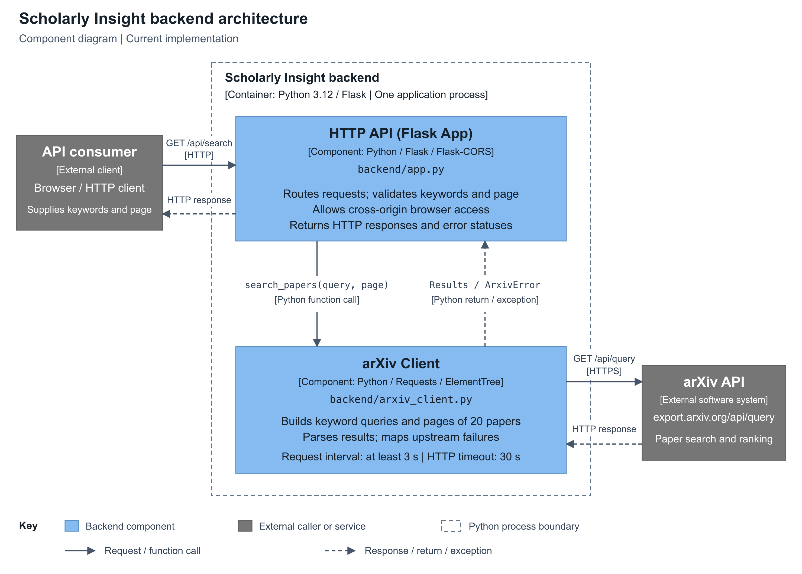

# Scholarly Insight Backend

A minimal Python/Flask backend with arXiv keyword search, JSON results in pages of 20, and a lightweight health endpoint.

**Deployment target: a publicly accessible cloud-hosted web application.**

## Backend architecture



[Editable diagram source (SVG)](docs/backend-architecture.svg)

The dashed boundary contains one running Python application. Both backend modules run inside this process.

- **API consumer:** a browser or HTTP client that submits search keywords and a page number.
- **HTTP API (`app.py`):** Flask routes requests, validates inputs, and creates HTTP responses. Flask-CORS permits browser access from another origin.
- **arXiv Client (`arxiv_client.py`):** constructs queries and pagination, controls request spacing, and handles upstream failures. Requests sends the external HTTP call; ElementTree parses the response.
- **arXiv API:** the external service that searches papers and ranks matches by relevance.

Solid arrows show requests or function calls; dashed arrows show responses, returns, or exceptions. The HTTP API calls `search_papers(query, page)` directly inside the same process. The arXiv Client communicates with arXiv over HTTPS. Results return through the client and HTTP API to the caller.

Notation follows the [C4 component diagram examples](https://github.com/plantuml-stdlib/C4-PlantUML/blob/master/samples/C4CoreDiagrams.md), with component names, technologies, responsibilities, a process boundary, and labelled relationships.

## Implementation and features

- `app.py` exposes `GET /api/search` and `GET /api/health`, validates search parameters, and returns JSON responses. Flask-CORS allows frontend access from another origin.
- `arxiv_client.py` calls the arXiv API with Requests and parses Atom/XML with Python's standard library. Requests are serialized and start at least three seconds apart; upstream HTTP calls use a 30-second timeout.
- Keywords search arXiv metadata. Multiple terms are combined with `AND`; results use arXiv's relevance ranking.
- Pagination fetches only the requested page: `start = (page - 1) * 20`. Each page contains up to 20 papers.
- Results include titles, authors, abstracts, categories, submission/update timestamps, and arXiv/PDF links.
- Input validation, upstream failures, timeouts, and invalid upstream responses produce JSON errors.
- No frontend, database, persistent search results, accounts, or notifications are included in this milestone.

## API contract

### Paper search

```http
GET /api/search?q=transformer&page=1
```

`q` is required and must contain 1-300 characters after whitespace normalization. `page` is a positive integer and defaults to 1. Page size is fixed at 20.

The response contains `query`, `page`, `page_size`, `total`, `total_pages`, `has_previous`, `has_next`, and `items`.

Each paper in `items` contains `id`, `title`, `authors`, `abstract`, `submitted_at`, `updated_at`, `categories`, `abstract_url`, and `pdf_url`. Authors and categories are arrays; `pdf_url` can be `null`. `submitted_at` is the first arXiv submission date, not a journal publication date.

The frontend renders `items` and uses the pagination flags to request adjacent pages. A query with no matches returns HTTP 200 with an empty array and zero totals. Matching, ranking, and result availability are controlled by arXiv.

Errors follow this format:

```json
{"error": {"code": "INVALID_PAGE", "message": "page must be a positive integer."}}
```

Status codes: 400 for invalid inputs, 502 for upstream failures or invalid data, 503 for upstream rate limiting, and 504 for upstream timeouts. Unknown routes return 404; unsupported methods return 405.

### Backend health

```http
GET /api/health
```

A running backend returns HTTP 200 with `Cache-Control: no-store` and this JSON body:

```json
{"status": "ok"}
```

`health()` verifies that the backend can respond to this request. It does not call arXiv, run the test suite, or verify every search feature. It remains available when arXiv/search is unavailable. No authentication or parameters are required, and CORS permits cross-origin GET requests.

## Development setup

Follow the [project setup](../README.md#running-and-integrating-the-backend) to create the `scholar` Conda environment. Run all commands from the repository root:

```bash
conda activate scholar
python -m pip install -r requirements.txt
python -m backend.app
```

Open `http://127.0.0.1:8000/api/health` to check backend reachability. Use `http://127.0.0.1:8000/api/search?q=transformer&page=1` for a real search, changing `page` to 2 for the next page. Stop the server with `Ctrl+C`.

The command above starts the development server at `http://127.0.0.1:8000`. After cloud deployment, clients use the deployed base URL with the same API paths. Hosting and production server configuration will be documented when deployment is added. The current in-memory arXiv request limiter coordinates one Python process; multiple workers or instances require shared coordination.

## Testing

```bash
python -m unittest discover -s backend/tests -v
```

`tests/test_backend.py` checks application behavior and API contracts. Run it during development or in continuous integration before a release. These tests are independent of whether the service is hosted locally or in the cloud. They do not run on browser refresh, start a live server, or contact the real arXiv API.

The table groups all 22 tests into 11 areas. Check names link to representative test methods. `health()`, `search()`, `error_response()`, and `handle_http_error()` are in [app.py](app.py); `search_papers()` and `_text()` are in [arxiv_client.py](arxiv_client.py).

| Check                                                          | Function or configuration                               | Check logic                                                                                                                                                             | Why it matters                                                                        |
| -------------------------------------------------------------- | ------------------------------------------------------- | ----------------------------------------------------------------------------------------------------------------------------------------------------------------------- | ------------------------------------------------------------------------------------- |
| [Backend health](tests/test_backend.py#L231)                    | `health()`, `CORS(...)` configuration               | Verify HTTP 200 with `status: ok`, no-store caching, and no arXiv calls. Health remains available after a search failure; cross-origin GET and preflight are allowed. | Provide an inexpensive backend reachability check without consuming the search quota. |
| [Input validation](tests/test_backend.py#L180)                  | `search()`, `error_response()`                      | Missing/blank/overlong keywords or invalid pages return HTTP 400; the upstream search is not called.                                                                    | Reject invalid requests before using the external API.                                |
| [HTTP contract and normalization](tests/test_backend.py#L165)   | `search()`                                            | Verify HTTP 200 JSON, default page 1, page size 20, normalized spaces, and forwarding of an explicit page number.                                                       | Give the frontend predictable parameters and response fields.                         |
| [Search query construction](tests/test_backend.py#L86)          | `search_papers()`                                     | Verify that multiple terms use AND, quotation marks are escaped, and sorting uses relevance.                                                                            | Send the intended keyword query to arXiv.                                             |
| [Metadata and compatibility](tests/test_backend.py#L51)         | `search_papers()`, `_text()`                        | Compare parsed fields with sample XML; normalize whitespace, allow a missing PDF, and preserve legacy IDs and versions.                                                 | Handle normal metadata variations without losing paper information.                   |
| [Pagination and empty results](tests/test_backend.py#L64)       | `search_papers()`                                     | Mock 21 papers: request offsets 0/20, return 20/1 items, and check totals and navigation flags. Zero matches produce an empty list and zero pages.                      | Keep page windows and navigation correct, including the last or empty page.           |
| [Invalid upstream data](tests/test_backend.py#L111)             | `search_papers()`                                     | Malformed XML, a non-feed response, an error entry, missing totals, or negative totals raise an upstream error with status 502.                                         | Distinguish broken upstream data from a valid search with no matches.                 |
| [Upstream failures and JSON errors](tests/test_backend.py#L126) | `search_papers()`, `search()`, `error_response()` | Simulate timeout, connection failure, and upstream HTTP 429; expect 504/502/503. Verify that the route preserves the status and JSON error structure.                   | Report failures clearly so the frontend can show an appropriate message.              |
| [Request spacing](tests/test_backend.py#L146)                   | `search_papers()`                                     | With a simulated clock, a second request arriving one second after the first must wait two more seconds.                                                                | Verify the calculation used to respect the three-second request interval.             |
| [Browser cross-origin access](tests/test_backend.py#L204)       | `CORS(...)` configuration in `app.py`               | Simulate a frontend Origin and an OPTIONS preflight; verify the allow-origin and GET method headers.                                                                    | Allow a frontend on another origin to read API responses.                             |
| [Unknown routes and methods](tests/test_backend.py#L218)        | `handle_http_error()`, `error_response()`           | Request an unknown route and POST to the GET-only search route; expect JSON errors with 404 and 405.                                                                    | Keep HTTP errors consistent with the JSON API.                                        |
